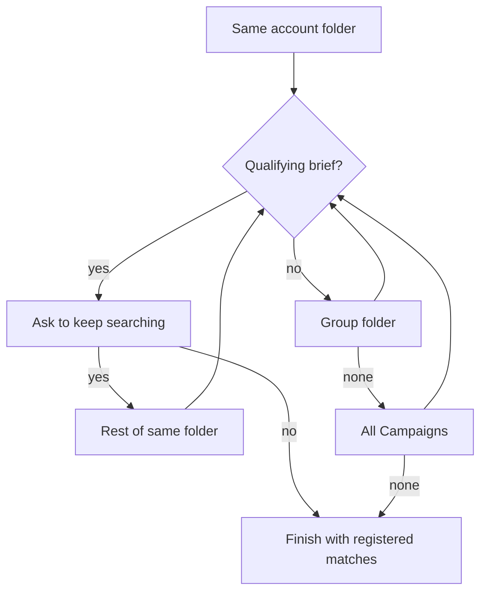

# Brief similarity backend

Pair cards stay as they are. The new score is between two briefs. Campaign pairs remain the evidence and the rows written for later learning.

## Consult Supabase in the workflows that use it

These paths in [workflow.py](c:\nicole\Brief Tutor\graph\workflow.py) already call [SupabaseWorkflowRepository](c:\nicole\Brief Tutor\graph\supabase\repository.py). Each one reads before it writes, when `is_supabase_configured` is true:

- Brief retrieval and `brief_creator_node`: load the saved brief and campaigns before parsing the spreadsheet.
- Diagnosis (`_persist_diagnoses` and the formatter): load the brief from Supabase, and load the latest `campaign_diagnoses` for that brief so a repeat run starts from stored history instead of an empty parse.
- Similarity (`_persist_similarity_matches`, `_apply_similarity_agent_cache`, OEM account lookup, candidate persist): load the target brief and any candidate brief already stored, read `brief_similarity_matches` and the agent cache before comparing, and read dealership OEM metadata before widening past the account folder.

A configured Supabase client that cannot be imported or reached does not fail quietly inside `agent_memory`. The run snapshot and the brief history response include that error, and the workflow does not continue as if the database had been consulted. Local spreadsheet parsing remains the fallback only when Supabase is not configured, or when the brief or candidate row is missing.

## Reload a brief from Supabase

`campaigns` rows already store headline, offer, body, CTA, disclaimer, `style_descriptions`, and `assets` ([repository.py](c:\nicole\Brief Tutor\graph\supabase\repository.py) `_campaign_payload`). Add `load_campaign_brief(spreadsheet_path)` that reads `briefs` plus `list_campaigns_by_brief_fk` and rebuilds the existing `CampaignBrief` / `Campaign` models.

`brief_creator_node` in [workflow.py](c:\nicole\Brief Tutor\graph\workflow.py) uses that load when the saved `source_file_hash` matches the file. Diagnosis and similarity then skip the brief-creator agent and continue with the saved models. A changed file is parsed again and upserted.

**Retrieve info** replaces the stub in [route.ts](c:\nicole\Brief Tutor - Frontend\src\app\api\briefs\retrieve\route.ts). A new `POST /api/briefs/retrieve` on [server.py](c:\nicole\Brief Tutor\api\server.py) runs the spreadsheet parser brief creator already uses (`parse_local_spreadsheet_to_campaign_brief`), then `_persist_brief_and_campaigns`, and returns `CampaignBriefView` (`available: true` plus campaigns). It does not start diagnosis or similarity.

Opening a brief calls `GET /api/briefs/history?spreadsheetPath=`. That returns the saved brief fields, campaigns, the latest diagnosis rows for that brief, and saved brief-to-brief similarity matches. [workbench.tsx](c:\nicole\Brief Tutor - Frontend\src\components\workbench.tsx) fills general info, the campaign carousel, and the Diagnoses / Similarity tabs from this payload only.

## Stop using the results folder

New runs do not write or read `results/` as their record. These writers stop:

- `*-diagnoses.json` from the diagnosis formatter in [workflow.py](c:\nicole\Brief Tutor\graph\workflow.py)
- `results/similarity/*-family-similarity.json` and the similarity `.txt` report from `write_family_similarity_outputs` in [tools.py](c:\nicole\Brief Tutor\graph\tools.py)
- Brief resume and full-listing `.txt` files from the document creator tool, which today writes into `results/`

The document creator reads diagnoses from the in-memory run state and from `campaign_diagnoses`, not from a JSON file it just saved. Similarity reports and diagnosis documents are stored on the analysis run in Supabase (text columns on `analysis_runs`, or the existing diagnosis and `brief_similarity_matches` rows) and returned by the history endpoint. The run snapshot’s `result` is built from that same payload, so the frontend does not open `results/` after a run.

[server.py](c:\nicole\Brief Tutor\api\server.py) search keeps listing Campaigns spreadsheets. It no longer treats `*-diagnoses.json`, `*-family-similarity.json`, or `workflow_results.json` as the source for a brief’s diagnoses or similarity. Files already in `results/` are left on disk and are not migrated or deleted in this step.

## Brief-level similarity

`compare_briefs_and_rank` in [tools.py](c:\nicole\Brief Tutor\graph\tools.py) still assigns one-to-one pairs and still returns `absolute_pairs`, `likely_pairs`, and `review_pairs` for the carousel.

Add a brief summary on that result:

- `brief_similarity_score`: average `similarity_score` of the pairs that meet the existing review threshold, taken over the smaller brief. Extra campaigns on the longer brief do not count as zeros.
- `match_kind`: `aligned` when both briefs have the same campaign count and those pairs cover them; `complementation` when the counts differ and every campaign on the shorter brief is paired at or above the likely threshold (one brief is a piece of the other). Otherwise `none`.
- `coverage`: paired campaigns on the shorter brief divided by that brief’s campaign count.

The family-similarity payload and the API artifact expose this per candidate file. The Similarity tab’s headline percent uses `briefSimilarityScore` and shows “Complementation” when that is the kind. Pair cards stay underneath for the match detail. That payload is stored in Supabase and returned by the history endpoint; it is not written under `results/similarity`.

New table `brief_similarity_matches` (SQL next to [similarity_agent_cache_schema.sql](c:\nicole\Brief Tutor\sql\similarity_agent_cache_schema.sql)): target brief, candidate brief, score, match kind, coverage, and the pair payload. `campaign_similarity` pair rows are still written. History reads the brief-level rows, not a fresh average of pairs.

## Ask before searching further

Today [family_similarity_analysis_node](c:\nicole\Brief Tutor\graph\workflow.py) scans the account folder and, if nothing qualifies, widens through OEM, group, and all of Campaigns by itself.

Change that to:

1. Walk the account folder (same folder as the target). Compare briefs until one candidate has `match_kind` of `aligned` or `complementation`.
2. Persist that match, put it on the run result, and set the job to `awaiting_input` with the candidate name and the next place a search would look.
3. Wait. `POST /api/runs/{id}/continue` with `{ accept: true | false }` resumes the worker.
4. Decline finishes with the matches already registered.
5. Accept keeps going: remaining files in the same folder, then the group folder when `has_group_folder` is true, then every other spreadsheet under Campaigns. The next qualifying brief stops the walk and asks again.
6. A scope with no qualifying brief does not ask; it moves to the next scope. When the last scope is finished, the run completes and says the search is done.

The frontend poll already reads the run snapshot. When `status` is `awaiting_input`, the Similarity tab shows the question and Yes / No. Yes and No call the continue route. The rest of the page stays locked until the run finishes or the user declines.
